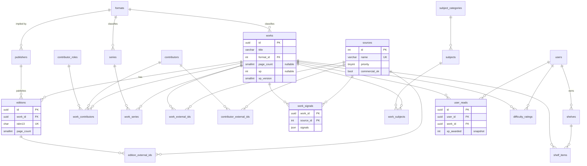

# Database

MySQL 8, database `plotline_dev` (name comes from `MYSQL_DB_NAME`). The schema is **source-agnostic**: OpenLibrary, Wikidata, GCD, Google Books and user input all feed the same tables, and every fact records which source it came from.

Schema files live in `db/creation/` and run in numbered order. The tables themselves are the source of truth for columns; this page explains the structure and the reasons behind it.

## Rebuilding the dev database

```bash
bun run db:reset              # drop + recreate, seed lookups and subjects, load dummy data
bun run db:reset --no-dummy   # same, without dummy data
```

`db/reset.ts` pipes the SQL into the `plotline-mysql` container as root, through the Docker context in [infrastructure.md](infrastructure.md). It refuses any database name that doesn't end in `_dev`. There are no migrations: the dev data is disposable, so schema changes go straight into `db/creation/` and the database is rebuilt.

When adding a table, add it to the right numbered file (lookups before the tables that reference them) and to the file list in `db/reset.ts` if you create a new file.

## Areas

### Catalog: what a book is
- **works**: the story, or for comics and manga, one **collected edition** (trade, volume or omnibus). Holds the canonical `page_count` and the final `xp`. Both are nullable: unknown is `NULL`, never `0`.
- **editions**: a specific printing: ISBNs, publisher, per-printing page count, cover. External sources match on ISBNs, so they link here.
- **formats** (lookup): `prose`, `comic`, `manga`, `picture_book`, each with an XP `density` multiplier.
- **publishers**: `implied_format_id` gives a cheap format guess (Viz → manga).
- **contributors** + **contributor_roles** + **work_contributors**: people link to works through a role (author, writer, artist, ...).
- **series** + **work_series**: `position` is decimal, so it can hold values like Vol. 3.5.

### Sources and XP: where facts came from
- **sources** (lookup): each provider's name, licence, `commercial_ok`, attribution text and `priority` (higher wins when sources disagree). Also holds identifier-only namespaces such as goodreads. See [data-sources.md](data-sources.md).
- **work_external_ids / edition_external_ids / contributor_external_ids**: the key is `(source_id, external_id)`, so one ID can never attach to two records.
- **work_signals**: the fields each source provided for a work (not raw API responses), stored as JSON. XP can be recalculated from this table without calling any API.
- **subjects** + **subject_categories** + **work_subjects**: subject difficulty values for XP. See [xp.md](xp.md).

### Users and reading
- **users**, **shelves**, **shelf_items** (optionally pointing at an edition).
- **user_reads**: one row per read. `xp_awarded` is copied when the read is finished, so formula changes never alter plotpoints already earned.
- **difficulty_ratings**: Plotline's own difficulty data (1-5).

## ERD



## Conventions

- **IDs:** entity tables use `BINARY(16)` UUIDs. The app generates them with `newUuid()` (v7, time-ordered) and converts with `uuidToBinary()` / `binaryToUuid()`. Lookup tables use `INT AUTO_INCREMENT`.
- **Lookup tables, not ENUMs:** formats, roles, sources and subject categories are rows. To tune or add one, change the rows, not the schema.
- **Lookups by name in SQL:** mutations resolve names with subqueries, e.g. `(SELECT id FROM sources WHERE name = ${source})`. An unknown source or role resolves to `NULL` and fails a `NOT NULL` constraint instead of being dropped silently. (`format_id` is nullable, so an unknown format name is stored as `NULL`.)
- **Transactions:** mutations take an optional executor (`db: SQL = mysql`), so repos can run several inside `mysql.begin(async tx => ...)`.
- **Dates:** read `DATE` columns with `toDateString()`. Bun returns them as local midnight, so `toISOString()` gives the wrong day in NZ.

## Decisions

| Decision | Why |
|---|---|
| No table is named after a single source (no `*_ol`) | Adding a provider means adding a `sources` row, not new tables |
| Works vs editions | ISBNs and page counts belong to printings; every external source matches on ISBN |
| Comics are collected editions; single issues aren't tracked | Matches how people log comics. A `work_contents` table (a collection and the issues it contains) can be added later without changing other tables |
| XP has a version, and history is locked | `works.xp_version` finds outdated scores; `user_reads.xp_awarded` protects earned totals |
| GCD data will live in a separate `gcd` database | Monthly refreshes can't touch app data, and the CC BY-SA data stays isolated. Only extracted signals and IDs get copied in |
| Redis is cache only | Anything that must persist is stored in MySQL |

## Gotchas

- **Bun ≥ 1.4 is required.** Bun 1.3.x's MySQL client doesn't roll back failed transactions and can hang the connection pool.
- **`READS` is a reserved word** in MySQL, which is why the table is `user_reads`.
- **`bun test` forces UTC,** so timezone bugs won't show up in tests.
